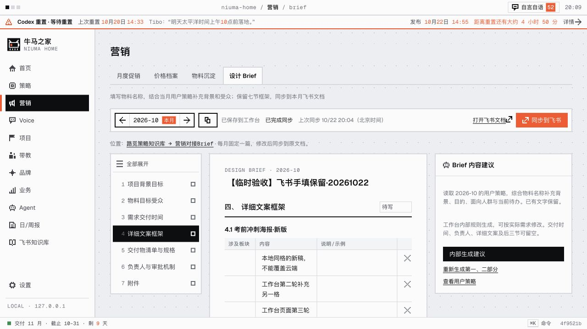
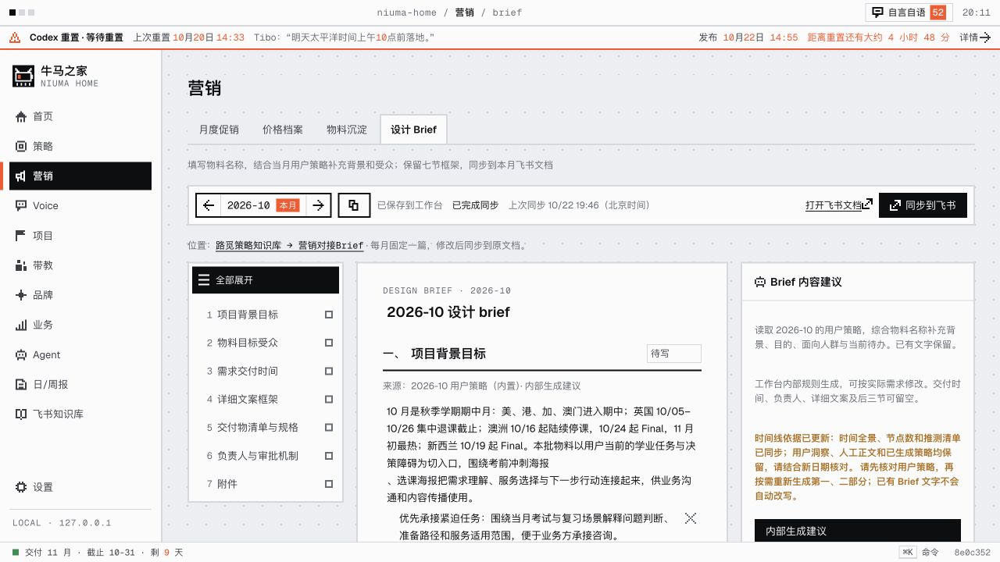

# Brief 飞书手填内容保留修复与真实验证

2026-10-22。用户要求：飞书直接补写详细文案后，再修改工作台 Brief 同步，人工内容必须保留；沿当前授权修复、完整验证并更新正式工作台。

## 确认的原因

旧逻辑把“上一次同步时已经看到的飞书内容”当成后续可以覆盖的基线。第一轮更新背景虽然保留了云端手填内容，第二轮再改同一物料的另一格时，整体替换物料文案就可能清空此前保留的云端文字。隔离回归已复现，不能由上一轮单次更新通过推断多轮同步安全。

## 修复边界

- 比较工作台上一版与当前飞书内容，持续保护两边差异；已看过的云端文字不等于已授权覆盖。
- 默认详细文案、规格和负责人表格按变化单元格更新；未改格、额外段落、链接、资源及对应原块 ID 保留。
- 同格双改、删除已补写物料先显示差异，不进行默认覆盖。缺少明确的逐项选择时拒绝写入。只有用户显式选择采用工作台内容才会替换对应冲突项。
- 表头、行列结构或可识别行位置变化导致对应不明时停止同步，保留原文档；不会按错位坐标写入。
- 保留七节布局、内部规则生成、自动保存和每月固定一篇的行为。

## 真实验证

使用同一机械邪龙兽应用 codex profile / user 身份，在原目标目录创建一篇明确命名的临时验收文档，隔离本地数据。通过独立飞书写入模拟用户补写，再走工作台实际同步服务及浏览器页面。

| 步骤 | 结果 |
| --- | --- |
| 飞书补写 | 详细文案加粗文字、换行和链接；表外额外段落；负责人手填，共3个保护块 |
| 修改工作台背景、交付日期后同步 | 临时文档版本6→8，3块完整 XML 和块 ID 不变 |
| 再改同物料另一格、另一位负责人 | 版本8→10，手填内容仍完整 |
| 改物料名称并新增物料 | 版本10→14，原手填内容和额外段落保留 |
| 重复同步 | unchanged，版本仍14，零写入 |
| 修改同一格 | 写入前返回冲突；缺少选择也拒绝，全文和版本均不变 |
| 明确采用飞书内容 | 版本仍14；两端各自填写内容保留 |
| 删除已补写物料 | 写入前返回冲突，零删除；隔离本地草稿恢复 |
| 浏览器编辑第三格并同步 | 自动保存后同步完成，仅1次有效更新，版本14→15；3个手填块再次逐字节一致 |
| 浏览器再次点击同步 | 版本仍15，无新增有效写入 |
| 原正式文档保护 | 本轮只读，版本始终24，全文哈希一致；没有改写原文档或另建替代文档 |

飞书页面的自动化读取超时，未重复发送写入；通过完整 XML、版本、原块 ID 与实际写入计数回读确认结果。工作台实际页面截图见下。原始验证证据保存在本机 `~/Library/Application Support/NiumaHome/evidence/niuma-brief-preserve-20261022/`；库内保存不含正文的结果摘要，避免依赖临时文件作为唯一记录。

## 工程检查与发布

- 新增21个保护回归用例：跨轮保留、同格冲突、删除、图片/链接、空首列、云端独有内容与行列移动等。
- 全量607/607通过，0失败、0跳过；构建与差异检查通过。构建保留原有大包体积提示。
- 独立审查发现的行列错位场景已全部修复并通过复验。
- 发布前正式数据与备份对比：7类业务表、全部49条v3_documents、人工Brief和1058条大学日期节点均一致；5个已核查日期源文件未改。
- 临时验收文档已清理并回读成功，原目标目录恢复为完全相同的6个节点。正式已采用 `nm-20261022-201044-8e0c352`，代码8e0c352，PID41384，端口5280。独立只读复核launchd、监听进程、首页和2个Brief服务文件均与快照一致；49条记录及全部业务表、人工Brief和1058条日期节点与发布前一致，错误日志为空。正式页面保留原文档链接，显示已有同步状态。临时5308服务已停止。

## 使用方式

刷新正式工作台，仍在「营销 → 设计 Brief」点击「同步到飞书」。飞书补写详细文案后，工作台修改其他位置可正常同步，人工文案保留。若同一处两边都改了，或删除已填物料，页面先给出差异；选择保留飞书内容即可，未选择不会写入。云端改动不会自动回填工作台输入框。

