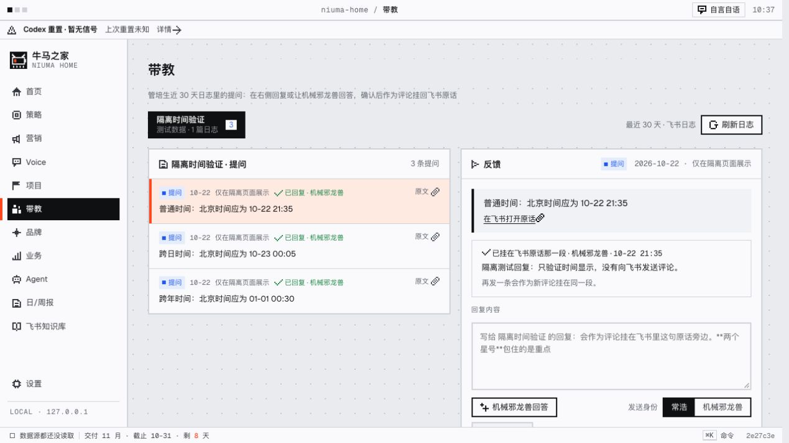

# 带教回复北京时间修复

日期：2026-10-23；用户授权保留已有内容和布局，修复带教回复时间后验证并发布。

## 原因与修改

`server/mentor.mjs` 的回复回执使用 `toISOString()`，正确保存带 UTC 标记的时间。旧页面直接截取 `reply.at`，没有转换时区，导致 `2026-10-22T13:35:00Z` 显示成 `10-22 13:35`，而不是北京时间 `10-22 21:35`。

- 新增 `src/modules/projects/mentor-view.js`：显式按 `Asia/Shanghai` 格式化，午夜使用 00 点；缺失、无效或未注明时区的异常值显示 `—`，不猜测时间。
- `ProjectsPage.jsx` 仅替换回复时间表达式，保留 `MM-DD HH:mm` 字符格式、原有 DOM 和 class，悬浮提示“北京时间”。
- 未修改后端、数据库结构、回复原文/身份/时间值、发送及核对流程、日志日期字段或布局 CSS；旧带教地址仍使用同一页面。

## 验证

| 检查 | 结果 |
| --- | --- |
| 4 项定向回归 | 普通 UTC、显式 +08:00 / -04:00、跨日/跨年零点、异常值通过 |
| 宿主时区 | UTC、America/New_York、Asia/Shanghai 均显示相同北京时间 |
| 完整回归 | 668/668，通过；无 skipped/todo |
| 隔离浏览器真实组件 | 普通 `10-22 21:35`、跨日 `10-23 00:05`、跨年 `01-01 00:30` 显示通过；页面错误日志为空 |
| 独立代码复核 | 无遗漏、无范围扩张 |
| 发布构建 | 通过，保留原有 bundle 大小提示 |
| 正式运行 | `nm-20261023-103847-3200d0e`，PID 70616，正式 5280 正常 |
| 正式产物回读 | 首页及 JS 与快照一致，JS `/assets/index-Dy9weayl.js` 含新时间格式化 |
| 布局及后端保持 | CSS 文件与上一正式版逐字节相同，72 个 server 文件逐字节相同 |
| 正式页面 | 带教两位人员日志正常加载，页面版本为 `3200d0e`，无浏览器错误 |

时间展示使用纯合成的隔离回执测试，接口只允许 GET，未向飞书发送或补写任何评论，也未把样本写入正式数据。正式库当前没有本地回复回执，不把隔离样本宣称成正式新评论。临时 API 5309、页面 5310 已停止，测试数据只保留在临时审计目录。

## 内容保持

独立逐字段比较发布前备份与正式库：人工业务各表及全部 58 条本地文档相同；已核查日期及时间线其他字段相同，仅同步时间更新。带教近 30 天缓存正常移出 2026-09-23 的日志，两位人员各少一篇、分别少 1/2 条提问；所有保留日志、提问和来源正文逐字段相同。项目缓存仅 updated_at 变化；自聊仅读取时间变化。没有覆盖或删除人工内容、没有业务冲突。

[结构化验证摘要](验证摘要.json)保留脱敏核查结果。

## 产物与回退

代码提交 `3200d0e`；正式快照 `nm-20261023-103847-3200d0e`。上一个可回退快照 `nm-20261023-102725-0b61cd0` 保留。发布前备份、回归日志和运行核对在 `/tmp/niuma-mentor-time-20261023/`；发布脚本另存正式 SQLite 备份。

本轮发布沿用干净临时 checkout，明确指向正式工作台和数码世界数据目录；主工作区既有无关 untracked 未删除、未隐藏或加入提交。交接文档随后单独提交，不影响已发布代码。

使用：刷新正式工作台的带教页，已有或后续成功回复的时间会自动按北京时间显示，不需要重新发送回复。此次仅验证时间显示与运行采用，不替代用户自然使用验收。
