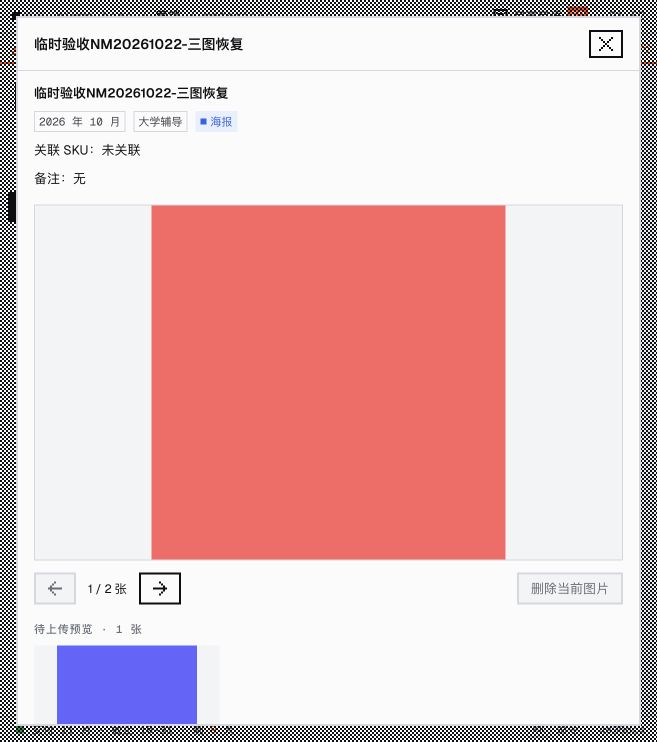
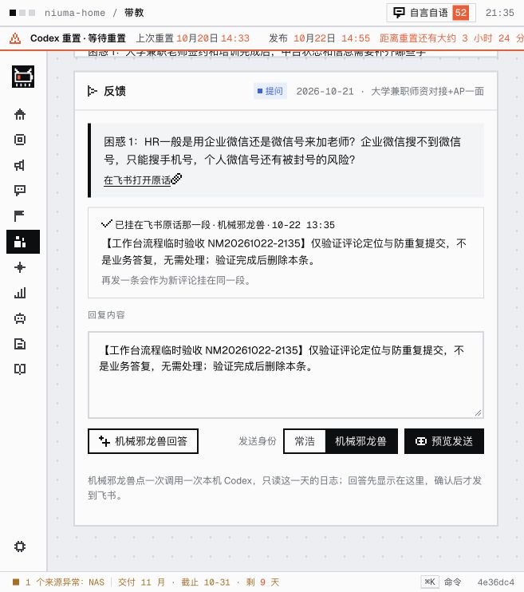
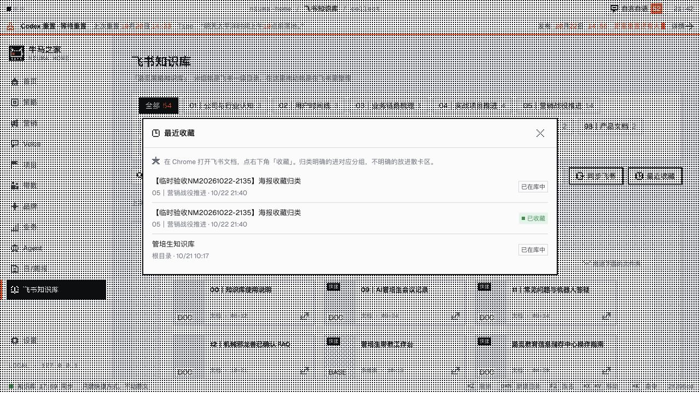

# 旧入口保护与真实集成验证

日期：2026-10-22。用户授权范围：补齐旧入口防重复提交，真实验证 NAS 新月份、带教回复、Chrome 收藏自动归类；保留布局及已有内容，冲突停止让用户选择，测试内容清理，验证通过后发布。其他预留功能不做。

## 当前结论

旧入口修复和可执行的验证已完成，**NAS 尚未挂载，真实新月份流程未验证，因此本轮候选未发布**。正式 5280 保持 `nm-20261022-204952-2f395cd`，PID 74743。已请用户挂载或明确暂缓，本轮没有自行解除发布条件。

## 修复范围

- 旧助手新建、编辑、导入；旧物料新建、编辑、删除及图片上传/删除；月度方案保存，共 9 个写入口使用持久操作编号。
- 编辑类入口同时校验原版本；重复编号同请求回原结果，编号挪用或内容冲突返回 409，缺失保护返回 428。完成回执与业务记录在同一 SQLite 事务。
- 浏览器在发送前持久保存操作编号、原草稿和版本。网络结果不明、关闭或刷新后继续核对原操作，未确认前不能换编号提交；冲突跨刷新保持停止。
- 多图逐张回读，已成功/已恢复的图片移出队列；剩余图片才可继续。图片失败补偿和删除时缓存清理纳入回归。
- 没有改布局 CSS、Brief、日期数据、价格和其他预留功能。接口合同见 [API](../../API.md)。

主要文件：`server/legacy-writes.mjs`、旧 assistants/marketing/materials 路由、`server/db.mjs` 的嵌套事务；`src/ui/legacy-write.js`、旧助手/物料/方案表单与上传；相应接口和客户端回归。

## 验证与证据

| 验证 | 环境与方法 | 结果 |
| --- | --- | --- |
| 完整回归 | 临时数据目录，`npm test` | 664/664，无 skipped/todo |
| 构建 | `npx vite build --outDir /tmp/niuma-legacy-20261022/dist --emptyOutDir` | 通过，JS `index-DM3Y7-o1.js`，CSS `index-B9OdAkaW.css` |
| 代码复核 | 独立只读复核；修复回读失败清编号、多图恢复队列、历史恢复事件、已确认后额外读取等问题 | 最终无待修阻断 |
| 助手双击新建 | 5310 页面 → 5309 隔离库 | 仅 1 个助手，无模型调用 |
| 助手响应丢失 | 本地故障代理让 PATCH 已完成但响应丢失；刷新页面后重新打开表单并核对回执 | 草稿和原编号保留；仅 1 次 PATCH，无重建 |
| 三图中断恢复 | A 成功，B 已保存但响应丢失，C 停止；核对回执后继续 | A/B/C 各 1 次 POST；恢复后只剩 C |
| 物料双击删除 | UI 双击确认清理隔离物料 | 1 次 DELETE；物料、图片行、缓存文件均为 0 |
| 版本冲突/编号复用 | 隔离 HTTP 与客户端测试，跨刷新冲突拦截、回执失败和事务补偿 | 通过；不自动选择版本 |
| 带教真实回复 | 5310 隔离界面，真实飞书指定原话；机械邪龙兽 bot 双击确认 | 1 条正确锚点评论，回读身份/原话一致 |
| Chrome 自动归类 | 正式 5280 + 已安装 Chrome 插件；临时标题含“海报” | 到路觅策略知识库“05｜营销战役推进”；再次点击返回同一快捷方式 |
| NAS 新月份 | `/Volumes/跨部门综合资料/8.月度物料` 多次读取 ENOENT | **未验证：等待真实挂载** |

自动测试覆盖正常进程重启后的回执重放。图片补偿保证可捕获异常的恢复；未对强杀/断电时文件系统与 SQLite 的跨系统原子性作承诺。构建仍有原有大 bundle 提示，未在本轮扩大拆包范围。

### 隔离页面故障验证

隔离数据库复制自备份，Codex 推送关闭；API 5309，页面 5310，故障代理 5311。故障只作用于隔离请求，没有拦截正式 5280。

完成后通过 UI 删除临时物料及图片；没有会话的临时助手按精确 ID/名称清除。保留审计回执供排错，隔离服务已停止。正式旧助手/物料/方案数据没有测试写入。

### 带教真实验证与清理

目标为林瑶 10 月 21 日原话，Docx `GcwKdGzljozUeUxesWhctBQXnpe`，block `YPOfd88HDoLXHqx0XV5cbEWMnjb`。测试标记 `NM20261022-2135` 明确说明“非业务答复，无需处理，验证后删除”。所有调用使用 `lark-cli --profile codex`；发送/删除评论为同一机械邪龙兽 bot，读取个人资源为同应用 user。

双击产生唯一 comment `7699485308076690699` / reply `7699485308093500707`，完整分页回读匹配 1 条。清理仅删除该测试回复，重新分页后标记 0 条。原文 revision 38676→38677，XML 只多出无属性 span 包装；去除该包装后与原文完全一致，没有改动正文文字或业务格式。不能把 revision 变化表述成“原文版本完全不变”。隔离本地测试回复回执清理，正式 `mentor-reply` 保持 0。

### Chrome 真实验证与清理

目标空间 `7672588453183261977`（路觅策略知识库）；“海报”唯一命中目录 token `YRaEwzk6vifEaBkNMAgcMODtn6f`，当前目录名为“05｜营销战役推进”。

临时源节点 `FoHkwXRgiidVGYk9ElAcXeAZn5g` / Docx `Us6Id1CWIoqh4yxxi52cbG4knme`，生成唯一快捷方式 `GV6EwtGDfirJcVka0X4c44Canic`。第二次真实点击返回 duplicate、同一节点。两条操作回执分别以 `collect-4b9b96be-143c-42cd-98a4-4ff56a86ffa2`、`collect-0a5d9adc-8759-4827-8da2-90eb39714165` 留档。

清理前确认只有本轮临时内容且无子节点，先删快捷方式再删临时源；两个删除任务回读 success，节点查询均明确返回 131012“node has been deleted”。父目录恢复与基线完全相同的 9 节点。归档回执后，按精确 ID 与完整 payload 比较删除两条本地测试收藏记录，未清理其他收藏。正式点击“同步飞书”，测试标记在本地记录及快照均为 0。

运行中的 Chrome 插件 ID `aennijibldcpflelchdhngfkhcokielc`，来自相邻 `work-desk-t10/browser-extension/niuma-collect`，不是主库目录。原插件旧提示仍称“常浩的知识库”，实际服务端归类早已指向新库；本轮将主库现有 `content.js`、`manifest.json` 复制到已安装目录，Chrome 重载并刷新后提示已采用“牛马之家当前设置的知识库”。权限与归类规则未改，原两文件备份在 `extension-before/`。

## 数据保持和清理核对

根代理与独立复核逐行比较正式库和开始备份：assistants 5、plans 3、promos 24、settings 6、sku_aliases 2、materials 0、material_images 0、v3_needs 12、v3_documents 58，全部字段完全相同。已核查时间线、NAS、mentor、projects、营收、品牌、业务图表快照相同。

仅知识库与自聊的后台读取缓存/时间更新：知识库树、规则、70 篇文档数量不变；Brief 与两份日志的缓存字数/摘要/更新时间更新。缓存变化不等于本轮修改了对应正文，需与上述实际写入审计分开。正式没有测试标记、没有带教测试回执、没有知识库写锁。

结构化结果：[验证摘要](验证摘要.json)。SQLite 备份、完整请求与外部回执、测试和构建日志保存在 `/tmp/niuma-legacy-20261022/`；不将完整私人日志加入仓库。

## NAS 恢复后的唯一续接步骤

1. 用户挂载真实 `/Volumes/跨部门综合资料/8.月度物料` 后，先确认实际目录与既有月份，使用新的正式库只读备份创建隔离数据目录。
2. 优先验证 NAS 已有新月份实际物料。若需要临时样本，先记原目录/文件清单，仅创建明确本轮标记的单个样本；不改既有文件、不拿本地模拟目录冒充 NAS。
3. 真实点击“同步 NAS”，核对新月份、业务线、名称、图片及对应路径；再同步确认不重复。原有下月空列只是预留，不计为新物料验证。
4. 清理本轮样本/新建且空的目录，重新扫描恢复；只清理无引用且属于本轮的测试缩略图，不能全量删除缓存。
5. 重新跑完整检查，核对无未决真实写入与数据保持，再备份、确认本轮候选提交、发布并回读正式 5280。现有无关 untracked 不加入、不删除，不为发布脚本而隐藏它们；可从已核对提交导出干净发布目录，显式指向正式数据目录。
6. 若用户明确暂缓 NAS，按新决定发布已验证部分并保留 NAS 待办。未收到决定前不发布。

## 交接整理

`HANDOFF.md` 更新为当前入口；`CURRENT.md` 收敛当前状态/唯一下一步；原 ui-v3 交接与截至本轮的完整历史分别保留在 `docs/history/`。旧记录不再混在当前状态下冒充现状。

本轮观察到一个非阻断显示细节：带教回复时间目前截取 UTC（真实 21:35 的回执显示 13:35）。定位为 `ProjectsPage.jsx` 的时间字符串截取；回复目标、身份和内容不受影响。本轮未扩展修改，留待用户确认是否单独处理。

## 2026-10-23 续接结果

用户挂载后，真实 NAS 新月份、双业务线归类、重复同步、样本及缓存清理已通过；原有文件与数据保留，正式 5280 已更新为 `nm-20261023-102725-0b61cd0`。本记录上方“等待挂载”“未发布”“唯一续接步骤”为 10 月 22 日当时状态，已由 [NAS 新月份验证与正式发布](../NAS新月份验证-20261023/验证记录.md)接续完成。
